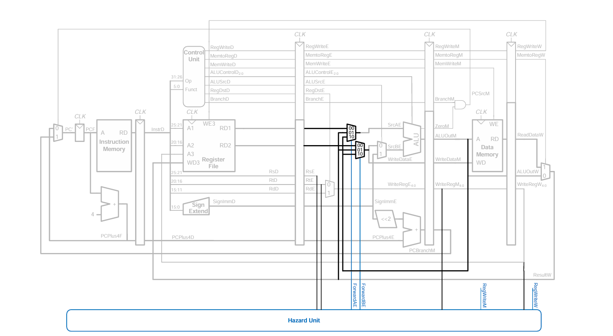

# RV32I Processor

A pipelined 32-bit RISC-V processor implementing the **RV32I base integer instruction set**, written in Verilog. The repository holds three designs that show how the project evolved:

| Design | Folder | Pipeline | Status |
|---|---|---|---|
| Classic RV32I core | [`RTL/`](RTL) | 5-stage (IF, ID, EX, MEM, WB) | Compiles and simulates; verified on the sample programs |
| Deep-pipeline RV32I core | [`optimised_deep_pipeline/`](optimised_deep_pipeline) | 7-stage (IF1, IF2, ID1, ID2, EX, MEM, WB) | Work in progress, does not elaborate yet (see [Known issues](#known-issues)) |
| Custom-ISA RISC model | [`RISC_processor_model/`](RISC_processor_model) | 5-stage, two-phase clock | Earlier learning project with its own (non-RISC-V) ISA |



---

## Features

**5-stage core (`RTL/`)**

- Full RV32I integer ISA: R-type, I-type arithmetic, loads, stores, branches, `JAL`, `JALR`, `LUI`, `AUIPC`
- Data forwarding from EX/MEM and MEM/WB into the EX stage (`operand_forwarding.v`)
- Load-use hazard detection with a one-cycle stall and bubble insertion (`hazard_detection.v`)
- Branches and jumps resolved in EX, with flushing of IF/ID and ID/EX on a taken redirect (static not-taken)
- Byte, halfword and word loads/stores with sign/zero extension (`LB`, `LH`, `LW`, `LBU`, `LHU`, `SB`, `SH`, `SW`)
- 32 × 32-bit register file with `x0` hard-wired to zero and a debug read port
- Harvard memories: 256-word instruction memory, 1024-word (4 KB) data memory, both loaded with `$readmemh`

**7-stage core (`optimised_deep_pipeline/`)**

- Split fetch (IF1/IF2) and split decode (ID1: control, ID2: register read + immediate) for a shorter critical path
- Valid bits carried through every pipeline register
- MEM→EX and WB→EX forwarding, plus a dedicated WB→ID2 bypass
- One-cycle load-use stall; taken branches/jumps resolved in EX and flush the younger stages
- Byte-addressable, little-endian instruction memory (4 KB) and data memory (8 KB)
- Debug outputs: `debug_pc`, `debug_wb_data`, `debug_wb_rd`, `debug_wb_we`

---

## Repository structure

```
RV32I-processor/
├── RTL/                          # 5-stage RV32I core
│   ├── PROCESSOR_CORE/core.v     # Top level: module `processor(Clk, Reset)`
│   ├── IF_STAGE/                 # PC, PC + 4 adder, instruction memory, IF/ID register
│   ├── ID_STAGE/                 # Register file, immediate generator, ID/EX register
│   ├── EX_STAGE/                 # ALU, ALU control, branch-target adder, EX/MEM register
│   ├── MEM_STAGE/                # Data memory, MEM/WB register
│   ├── HAZARD_DETECTION_UNIT/    # Load-use hazard detection, forwarding unit
│   ├── controller/control_unit.v # Main control unit (opcode decoder)
│   └── mux/                      # Parameterised 2:1 and 4:1 multiplexers
├── optimised_deep_pipeline/      # 7-stage RV32I core (top: rv32i_7stage_core)
├── RISC_processor_model/         # Earlier custom-ISA pipelined processor
│   ├── risc_processor.v
│   ├── proc_testbench/           # tb1.v (factorial), tb2.v (modulo)
│   └── simulations/              # Waveform screenshot of the factorial run
├── testbench/
│   ├── processor_tb.v            # Testbench for the 5-stage core
│   ├── sum of first 10 natural numbers prog   # RV32I machine code (hex)
│   ├── prog to check modulo to two numbers    # RV32I machine code (hex)
│   └── simulations/              # Waveform screenshot of the sum program
└── images/architecture_model.png # Pipeline block diagram
```

---

## 5-stage core in detail

### Datapath

| Stage | Modules | What happens |
|---|---|---|
| **IF** | `PC`, `PC_adder`, `instruction_mem`, `IF_ID_pipe_reg` | Fetch the instruction at PC; next PC chosen from PC + 4, branch, JAL or JALR target |
| **ID** | `main_control_unit`, `imm_gen`, `register_file`, `ID_EX_pipe_reg` | Decode, generate control signals and immediate, read `rs1`/`rs2` |
| **EX** | `forwarding_unit`, `ALU_control_unit`, `ALU`, `adder`, `EX_MEM_pipe_reg` | Forward operands, compute result, evaluate branch condition, compute targets |
| **MEM** | `data_memory`, `MEM_WB_pipe_reg` | Load or store with byte/halfword/word granularity |
| **WB** | 4:1 mux in `core.v` | Write ALU result, loaded data, or PC + 4 (for `JAL`/`JALR`) back to `rd` |

### Control signals (`main_control_unit`)

| Instruction | ALUOp | ALUSrcA | ALUSrcB | MemRead | MemWrite | RegWrite | WriteBackSel | Branch |
|---|---|---|---|---|---|---|---|---|
| R-type | `10` | rs1 | rs2 | 0 | 0 | 1 | ALU | 0 |
| I-type ALU | `11` | rs1 | imm | 0 | 0 | 1 | ALU | 0 |
| Load | `00` | rs1 | imm | 1 | 0 | 1 | Mem | 0 |
| Store | `00` | rs1 | imm | 0 | 1 | 0 | – | 0 |
| Branch | `01` | rs1 | rs2 | 0 | 0 | 0 | – | 1 |
| JAL | – | – | – | 0 | 0 | 1 | PC + 4 | 0 |
| JALR | `00` | rs1 | imm | 0 | 0 | 1 | PC + 4 | 0 |
| LUI | `00` | 0 | imm | 0 | 0 | 1 | ALU | 0 |
| AUIPC | `00` | PC | imm | 0 | 0 | 1 | ALU | 0 |

### ALU operations

| ALUControl | Operation | Used by |
|---|---|---|
| `0000` | AND | `AND`, `ANDI` |
| `0001` | OR | `OR`, `ORI` |
| `0010` | ADD | `ADD`, `ADDI`, loads, stores, `JALR`, `LUI`, `AUIPC` |
| `0110` | SUB | `SUB`, `BEQ`, `BNE` |
| `0011` | XOR | `XOR`, `XORI` |
| `0100` | Shift left logical | `SLL`, `SLLI` |
| `0101` | Shift right logical | `SRL`, `SRLI` |
| `1101` | Shift right arithmetic | `SRA`, `SRAI` |
| `0111` | Set less than (signed) | `SLT`, `SLTI`, `BLT`, `BGE` |
| `1000` | Set less than (unsigned) | `SLTU`, `SLTIU`, `BLTU`, `BGEU` |

The ALU also outputs `Zero`, `Less` (signed) and `LessU` (unsigned) flags, which `core.v` combines with `funct3` to decide `BEQ/BNE/BLT/BGE/BLTU/BGEU`.

### Hazard handling

- **Data hazards:** the forwarding unit gives the EX/MEM result priority over MEM/WB, and never forwards to `x0`.
- **Load-use hazards:** when the instruction in EX is a load whose `rd` matches `rs1`/`rs2` in ID, the PC and IF/ID register are frozen and a bubble is inserted into ID/EX for one cycle.
- **Control hazards:** branches and jumps resolve in EX. On a taken branch, `JAL` or `JALR`, the IF/ID and ID/EX registers are flushed (a two-cycle penalty).

---

## Test programs

Both programs are RV32I machine code (one 32-bit hex word per line) for the 5-stage core.

### Sum of the first 10 natural numbers

```asm
0x00  addi a0, x0, 10      # n = 10
0x04  addi a1, x0, 0       # sum = 0
0x08  addi a2, x0, 1       # i = 1
0x0C  add  a1, a1, a2      # loop: sum += i
0x10  addi a2, a2, 1       #       i++
0x14  bge  a0, a2, -8      #       if n >= i goto loop
0x18  sw   a1, 0(x0)       # mem[0] = sum
0x1C  jal  x0, 0           # halt (infinite loop)
```

Expected result: `a1 = 55`, data memory word 0 = `55`. **Verified in simulation.**

### Modulo of two numbers (21 mod 8)

```asm
0x00  addi a0, x0, 21      # a = 21
0x04  addi a1, x0, 8       # b = 8
0x08  blt  a0, a1, +16     # loop: if a < b goto 0x18
0x0C  sub  a0, a0, a1      #       a -= b
0x10  jal  x0, -8          #       goto loop
0x14  sw   a0, 0(x0)       # mem[0] = a mod b
0x18  jal  x0, 0           # halt
```

Expected result: `a0 = 5`. **Verified in simulation.** Note that the `blt` offset of `+16` jumps straight to the halt at `0x18`, so the `sw` at `0x14` never executes. Changing the first word on line 3 from `00b54863` to `00b54663` (offset `+12`) makes the program store the result to memory.

---

## Running the simulation

The 5-stage core needs only [Icarus Verilog](https://steveicarus.github.io/iverilog/) (or any Verilog simulator such as Vivado, ModelSim or Verilator) and GTKWave to view waveforms.

1. **Prepare the memory files.** `instruction_mem` reads `program.mem` and `data_memory` reads `data.mem` from the simulator's working directory:

   ```bash
   mkdir sim && cd sim
   grep -v '^\s*$' "../testbench/sum of first 10 natural numbers prog" > program.mem
   touch data.mem
   ```

2. **Use a testbench.** A minimal working testbench (save as `tb.v` in `sim/`):

   ```verilog
   module tb;
       reg Clk = 0, Reset = 0;          // Reset is active-low
       processor dut (.Clk(Clk), .Reset(Reset));

       always #5 Clk = ~Clk;

       initial begin
           $dumpfile("wave.vcd");
           $dumpvars(0, tb);
           #12  Reset = 1;              // release reset
           #2000;
           $display("a0=%0d a1=%0d mem[0]=%0d",
                    dut.registers.registers[10],
                    dut.registers.registers[11],
                    dut.memory.memory[0]);
           $finish;
       end
   endmodule
   ```

3. **Compile and run:**

   ```bash
   iverilog -g2012 -o cpu.out tb.v ../RTL/*/*.v
   vvp cpu.out          # prints: a0=10 a1=55 mem[0]=55
   gtkwave wave.vcd     # optional: inspect the pipeline
   ```

### Running the custom-ISA model

`RISC_processor_model/proc_testbench/tb2.v` (modulo) matches the processor's port list and runs directly:

```bash
iverilog -o model.out RISC_processor_model/risc_processor.v RISC_processor_model/proc_testbench/tb2.v
vvp model.out
```

`tb1.v` (factorial) connects 25 ports to a module that has 27 (it passes three register outputs instead of five), so it needs updating before it will elaborate.

---

## Custom-ISA RISC model

`RISC_processor_model/risc_processor.v` is an earlier five-stage pipelined processor with its own 32-bit instruction format (6-bit opcode), a 16-bit PC, 32 registers and a 256-word unified memory. It is driven by two non-overlapping clocks and has no hazard logic, so the test programs insert delay instructions between dependent operations. Its instruction set includes `ADD`, `SUB`, `MUL`, `DIV`, `MOV`, shifts, immediate variants, `AND`/`OR`/`XOR`, `CMP`, `LWD`, `STR`, `BEQZ`, `BNEQZ` and `HLT`. The two testbenches compute a factorial (`tb1.v`) and a modulo (`tb2.v`); a waveform of the factorial run is in [`RISC_processor_model/simulations/`](RISC_processor_model/simulations).

---

## Known issues

These were found while checking every file with Icarus Verilog 12 and are listed so they can be fixed.

**5-stage core (`RTL/`)**

- `testbench/processor_tb.v` does not compile: there is a trailing comma after `.Reset(Reset)` in the port list, and the clock is toggled as `clk` instead of `Clk`. The testbench also does not load a program or stop the simulation. Use the testbench above until it is fixed.
- `core.v` connects `debug_reg_select` and `debug_reg_out` on the register file without declaring them, so they are implicit 1-bit wires (the simulator warns about padding). Either declare them or add them as top-level ports.
- `IMEM.v` loads `program.mem`, while the empty placeholder file in the repo is `RTL/IF_STAGE/instruction.mem`.

**7-stage core (`optimised_deep_pipeline/`)**

- `processor_core.v` does not elaborate because its instances do not match the module definitions:
  - `forwarding_unit` is given `mem_forward_data` (not a port) and is missing `rs1_ID2`, `rs2_ID2`, `uses_rs1_ID2` and `uses_rs2_ID2`.
  - `hazard_detection_unit` is given `IR_ID2` and `valid_ID2` (not ports) and is missing `uses_rs1_ID2` and `uses_rs2_ID2`.
  - `MEM_WB_reg` is given `PC_MEM` and `PC_WB`, which it does not have; `PC + 4` write-back for `JAL`/`JALR` needs them.
- The instruction memory is cleared on reset and the core ties its write port to zero, so there is currently no way to load a program. Adding `$readmemh` (or driving the write port from a testbench) is needed.
- `rst` is active-high here, unlike the active-low `Reset` of the 5-stage core.
- There is no testbench for this core yet.

---

## Roadmap

- [ ] Fix the module interfaces in the 7-stage core and add a program loader
- [ ] Add a self-checking testbench for each core
- [ ] Integrate a branch prediction unit (the 7-stage design is currently static not-taken)
- [ ] Run the official RISC-V compliance tests (`riscv-tests` / `riscv-arch-test`)
- [ ] Synthesise on an FPGA and report timing and resource use for both pipelines

---

## Author

**K. S. Sethurathnam**, Department of Electronics Engineering, IIT (BHU) Varanasi
